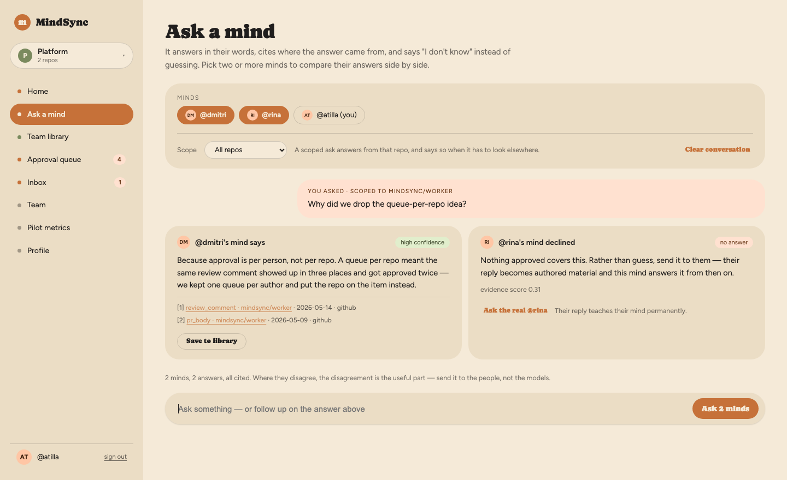

<h1>Atilla Can Uslu</h1>

**Software engineer — I build AI systems and the infrastructure underneath them.**

RAG pipelines, agent tooling, and serverless backends that run in production for real
users. USC ECE '25, currently shipping education-technology integrations at MemorySync
and building a team-knowledge platform on Azure.

Redmond, WA &nbsp;·&nbsp; [atillacanuslu@gmail.com](mailto:atillacanuslu@gmail.com)
&nbsp;·&nbsp; [LinkedIn](https://linkedin.com/in/atilla-can-uslu-599913201)

---

## MindSync — ask your teammates when they're not around

Every engineer carries context nobody wrote down. MindSync turns a person's own GitHub
history and AI coding sessions into a **mind** their teammates can question — from the
web or from inside Claude Code. It answers in their voice with citations, or says
**"I don't know"** and routes the question to the real person.

Two minds, same question. One cites the PRs it drew from; the other has no approved
material and declines rather than guessing. Sample data.

**What's interesting about it**

- **Hybrid retrieval** — BM25 + 1536-dim vectors fused with reciprocal rank fusion over Azure AI Search, then re-weighted by source trust × freshness × relevance.
- **It refuses.** An empirically measured relevance gate means a thin-evidence question gets a decline and an escalation to the real person, not a fabrication. Every ask is logged with its evidence score so the threshold is tuned from data.
- **Privacy is a test, not a promise.** Session capture splits your turns from the assistant's *on your machine* — guarded by an allowlist test that plants markers in assistant text, tool output, subagent prompts, and compaction summaries and asserts zero survive.
- **Consent by construction.** Nothing enters a person's mind unapproved, and nobody approves material into someone else's.

`Azure Functions` `Cosmos DB` `Azure AI Search` `Azure OpenAI` `Bicep` `TypeScript` `MCP` `GitHub Apps`

[**Live app**](https://delightful-desert-03fe1ac03.7.azurestaticapps.net/welcome) &nbsp;·&nbsp;
[**Code + architecture write-up**](https://github.com/atillacanuslu/mindsync-plugin) &nbsp;·&nbsp;
~$9.50/month to run &nbsp;·&nbsp; 176 tests

---

## Experience

**Software Engineer** — MemorySync LLC · *Sep 2025 – Present* · Redmond, WA 
Built **EduSync**, a cross-platform writing-analytics product, end to end: ingestion and
text-processing pipelines that parse student work across **Canvas LMS (LTI 1.3)**,
Microsoft Word, and Google Docs; a serverless multi-tenant backend on Firebase Cloud
Functions with JWT auth. Published on the **Canvas App Center, Microsoft AppSource, and
Google Workspace Marketplace** — active pilot at Seattle University.

**Software Developer Intern** — TaleWorlds Entertainment · *Summer 2023* · Ankara, Türkiye 
Shipped AI and gameplay features in C++/C# for **Mount & Blade II: Bannerlord** —
optimized NPC pathfinding for large-scale battles and built a dynamic random-encounter
mission system.

**Software Engineering Intern** — Credit Registration Office · *Summer 2022* · Istanbul, Türkiye 
Engineered C++ real-time, high-volume data-processing pipelines for credit-scoring
systems, cutting latency and improving reliability under heavy load.

---

## Other work

**[memorysync-ai](https://github.com/atillacanuslu/memorysync-ai)** — AI-powered personal
file assistant. A local-document RAG system with OpenAI embeddings over Qdrant, a
multi-format processing pipeline (PDF, DOCX, images with OCR), and an intent-classification
layer routing across 8 categories. Python Cloud Functions backend, Flutter macOS client
with live file-system monitoring.

---

## Toolbox

**Languages** — Python · C · C++ · C# · JavaScript · TypeScript · Dart

**AI / LLM** — RAG pipelines · hybrid search (vector + BM25, RRF) · Azure AI Search ·
Qdrant · OpenAI + Azure embeddings · semantic chunking · grounded generation with
citations · retrieval evaluation and threshold tuning · Model Context Protocol (MCP) ·
structured outputs · OCR

**Cloud & Backend** — Azure (Functions, Static Web Apps, Cosmos DB, AI Search, Key Vault,
Foundry) · Google Cloud Functions · Firebase · Node.js · serverless · queue-based async
pipelines · REST APIs · JWT auth · managed identity · Bicep / IaC · Docker

**Integrations** — LTI 1.3 · Canvas LMS API · Microsoft Graph · Google Workspace APIs ·
GitHub Apps and webhooks · Flutter

**AI-assisted development** — Claude Code · Cursor · Copilot, on a verify-before-trust
workflow: everything generated gets reviewed and tested before it ships.

---

## In progress

- Microsoft Certified: **Azure AI Apps and Agents Developer Associate (AI-103)**
- **AWS Certified AI Practitioner**

---

Open to software engineering roles — AI/ML infrastructure, backend, or full-stack.
Reach me at <a href="mailto:atillacanuslu@gmail.com">atillacanuslu@gmail.com</a>.
